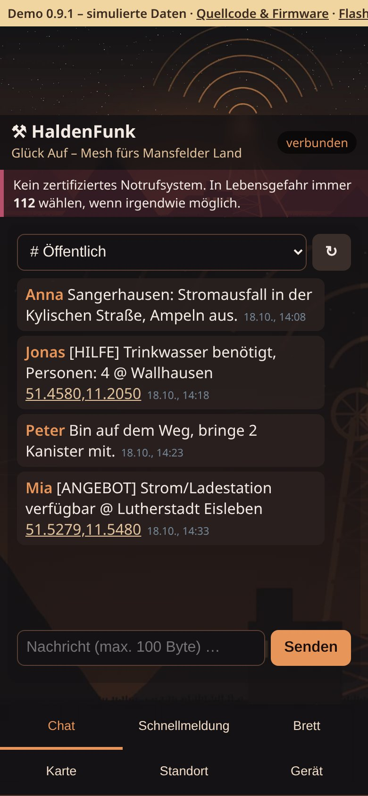
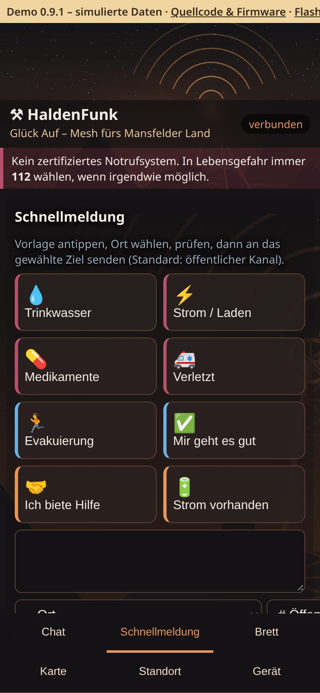
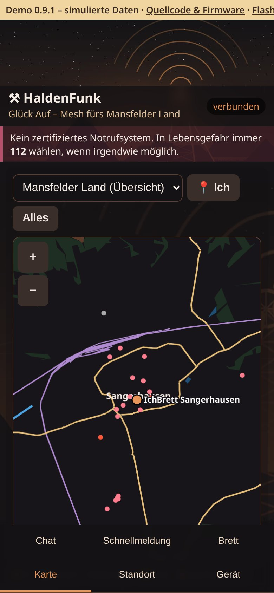

# HaldenFunk-MeshCore

**Glück Auf – Mesh fürs Mansfelder Land, mit MeshCore: HaldenFunk-Weboberfläche im offenen WLAN und gleichzeitig die offizielle MeshCore-App per Bluetooth – Chat, Brett und Offlinekarten ohne Internet.**

Aufnahmen der [Live-Demo](https://pietwars.github.io/HaldenFunk-MeshCore/) in Handygröße, Stand 0.9.1; alle Daten simuliert.

**Version 0.9.1** · MeshCore 1.18 · 868 MHz · Firmwarekennung `v1.18.0-hf0.9.1`

Flyer (A5): [Druck-PDF mit QR-Codes](docs/flyer/HaldenFunk-MeshCore-Flyer.pdf) · [Digital-PDF mit Links](docs/flyer/HaldenFunk-MeshCore-Flyer-digital.pdf) · [Vorschau](docs/flyer/HaldenFunk-MeshCore-Flyer-vorschau.jpg)

## Was kann es

- **Chat:** öffentlicher Kanal, eigene Kanäle und Direktnachrichten über MeshCore, Verlauf auf dem Board
- **Schnellmeldungen:** Trinkwasser, Strom, Medikamente, Verletzt, Evakuierung – mit Ortsangabe
- **Schwarzes Brett:** MeshCore-Room-Server, Beitritt automatisch mit dem öffentlichen Gast-Passwort `hello`
- **Karte und Standort:** Offlinekarten des Mansfelder Landes direkt aus der Firmware, Knoten und geteilte Positionen; Handy-GPS oder Ortsliste
- **WLAN + Bluetooth gleichzeitig:** Weboberfläche im Browser und parallel die MeshCore-App (Kopplung ohne PIN)
- **HaldenFunk-Design:** Kupfer und Anthrazit, Haldenmotiv; Admin (Name, Kanäle) nur für Betreiber

## Unterstützte Geräte

| Board | Paket im [Release v0.9.1](https://github.com/Pietwars/HaldenFunk-MeshCore/releases/tag/v0.9.1) | Stand |
|---|---|---|
| LILYGO T-Deck Plus (ESP32-S3, SX1262, 868 MHz) | `HaldenFunk-MeshCore-0.9.1-LilyGo_TDeck.zip` | baut und ist automatisch geprüft; auf Hardware ungeprüft (gleiche Basis wie DisAHRsterRadio-MeshCore, dort getestet) |
| Heltec WiFi LoRa 32 V2 (ESP32, SX1276, 868 MHz) | `HaldenFunk-MeshCore-0.9.1-Heltec_v2.zip` | baut und ist automatisch geprüft; auf Hardware ungeprüft |

Weitere Geräte der MeshCore-Konfigurator-Liste bleiben im Code, sind aber nicht im Release – siehe [Details](docs/DETAILS.md#alle-geräte-meshcore-konfigurator-liste).

## Schnellstart

1. **Flashen**
   - **T-Deck Plus:** [Web-Flasher](https://pietwars.github.io/HaldenFunk-MeshCore/flasher/) in Chrome oder Edge am Computer öffnen, Gerät per USB verbinden, installieren.
   - **Heltec V2:** ZIP aus dem [Release](https://github.com/Pietwars/HaldenFunk-MeshCore/releases/tag/v0.9.1) entpacken und `HaldenFunk-MeshCore-0.9.1-Heltec_v2-wifi-factory.bin` mit esptool bzw. esptool-js an Adresse **0x0** schreiben – [Anleitung Flashen](docs/FLASHEN.md).
   - Die `factory.bin` löscht Einstellungen, Identität und Kontakte; Update ohne Datenverlust: nur `teile-wifi/firmware.bin` an 0x10000.
2. **Verbinden:** Handy mit dem offenen WLAN `HaldenFunk-XXXXXX` verbinden, **http://192.168.4.1** öffnen – kein Passwort, höchstens 4 Handys.
3. **MeshCore-App (optional):** per Bluetooth koppeln, ohne PIN („Just Works“).
4. **Nur Betreiber:** Beim ersten Start zeigt der USB-Seriellmonitor (115200 Baud) das gerätespezifische Admin-Passwort. Details: [Offener Zugang](docs/OFFENER_ZUGANG.md)

## Funk

MeshCore-Preset **EU/UK (Narrow): 869,618 MHz**, 62,5 kHz, SF8, CR 4/8 (SRD-Teilband 869,4–869,65 MHz, 10 % Sendezeit). Alle Knoten eines Netzes brauchen dasselbe Profil. Funkt mit anderen MeshCore-Geräten (z. B. DisAHRsterRadio-MeshCore), **nicht** mit HaldenFunk/DisAHRsterRadio (LoRaLayer2) oder Meshtastic.

<!-- projektfamilie:start (in allen fünf Repositorys identisch; erzeugt mit DisasterMesh/tools/projektfamilie.py) -->
## Projektfamilie DisAHRsterRadio / HaldenFunk

| Repository | Inhalt | Funk | Version | Demo · Download · Flyer |
|---|---|---|---|---|
| [Pietwars/DisasterMesh](https://github.com/Pietwars/DisasterMesh) | Original-Repo: MeshCore 1.18 mit der großen Weboberfläche MeshAhrtal, Karten, Werkzeuge, Doku (Ahrtal) | MeshCore | 0.9.2 | [Live-Demo](https://pietwars.github.io/DisasterMesh/demo/) · [Release v0.9.2](https://github.com/Pietwars/DisasterMesh/releases/tag/v0.9.2) · Flyer [Druck](https://pietwars.github.io/DisasterMesh/flyer/DisasterMesh-Flyer.pdf) / [digital](https://pietwars.github.io/DisasterMesh/flyer/DisasterMesh-Flyer-digital.pdf) |
| [Pietwars/DisAHRsterRadio-MeshCore](https://github.com/Pietwars/DisAHRsterRadio-MeshCore) | MeshCore 1.18 mit kompakter MeshAhrtal-Oberfläche per WLAN plus Bluetooth für die MeshCore-App; Firmware für LILYGO T-Deck Plus und Heltec V2 (Ahrtal) | MeshCore | 0.9.1 | [Live-Demo](https://pietwars.github.io/DisAHRsterRadio-MeshCore/) · [Release v0.9.1](https://github.com/Pietwars/DisAHRsterRadio-MeshCore/releases/tag/v0.9.1) · Flyer [Druck](https://pietwars.github.io/DisAHRsterRadio-MeshCore/flyer/DisAHRsterRadio-MeshCore-Flyer.pdf) / [digital](https://pietwars.github.io/DisAHRsterRadio-MeshCore/flyer/DisAHRsterRadio-MeshCore-Flyer-digital.pdf) |
| [Pietwars/DisAHRsterRadio](https://github.com/Pietwars/DisAHRsterRadio) | Ohne MeshCore: modernisiertes disaster-radio (LoRaLayer2, RadioLib) mit kompakter MeshAhrtal-Oberfläche (Ahrtal) | LoRaLayer2 | 0.9.1 | [Live-Demo](https://pietwars.github.io/DisAHRsterRadio/) · [Release v0.9.1](https://github.com/Pietwars/DisAHRsterRadio/releases/tag/v0.9.1) · Flyer [Druck](https://pietwars.github.io/DisAHRsterRadio/flyer/DisAHRsterRadio-Flyer.pdf) / [digital](https://pietwars.github.io/DisAHRsterRadio/flyer/DisAHRsterRadio-Flyer-digital.pdf) |
| [Pietwars/HaldenFunk](https://github.com/Pietwars/HaldenFunk) | Regionalvariante von DisAHRsterRadio für Sangerhausen / Mansfelder Land, ohne MeshCore | LoRaLayer2 | 0.9.1 | [Live-Demo](https://pietwars.github.io/HaldenFunk/) · [Release v0.9.1](https://github.com/Pietwars/HaldenFunk/releases/tag/v0.9.1) · Flyer [Druck](https://pietwars.github.io/HaldenFunk/flyer/HaldenFunk-Flyer.pdf) / [digital](https://pietwars.github.io/HaldenFunk/flyer/HaldenFunk-Flyer-digital.pdf) |
| [Pietwars/HaldenFunk-MeshCore](https://github.com/Pietwars/HaldenFunk-MeshCore) | Regionalvariante von DisAHRsterRadio-MeshCore für das Mansfelder Land: MeshCore 1.18, WLAN + Bluetooth, Gerätematrix | MeshCore | 0.9.1 | [Live-Demo](https://pietwars.github.io/HaldenFunk-MeshCore/) · [Release v0.9.1](https://github.com/Pietwars/HaldenFunk-MeshCore/releases/tag/v0.9.1) · Flyer [Druck](https://pietwars.github.io/HaldenFunk-MeshCore/flyer/HaldenFunk-MeshCore-Flyer.pdf) / [digital](https://pietwars.github.io/HaldenFunk-MeshCore/flyer/HaldenFunk-MeshCore-Flyer-digital.pdf) |

Gleiche Spalte **Funk** = Geräte können miteinander funken (gleiches Funkprofil vorausgesetzt). MeshCore- und LoRaLayer2-Varianten verstehen sich **nicht**.

**Namen:** **DisAHRsterRadio** = Projekt und Marke (WLAN `DisAHRsterRadio-XXXXXX`) · **MeshAhrtal** = die Weboberfläche im Handy-Browser · **DisasterMesh** = das Original-Repository · **HaldenFunk – Glück Auf** = Regionalvariante fürs Mansfelder Land (WLAN `HaldenFunk-XXXXXX`).

Alle Demos sind simuliert.
<!-- projektfamilie:end -->

## Sicherheit

> ⚠️ Prototyp, **kein zertifiziertes Notrufsystem**. Im Notfall immer **112** wählen. Im offenen WLAN kann jede Person in Reichweite mitlesen und senden; Bluetooth koppelt ohne PIN.

## Mehr Doku

[Details (ausführlich)](docs/DETAILS.md) · [Anleitung Flashen](docs/FLASHEN.md) · [Offener Zugang](docs/OFFENER_ZUGANG.md) · [Änderungen](CHANGELOG.md) · [Original-README MeshCore](README.meshcore.md)

## Lizenz

[MeshCore](https://github.com/meshcore-dev/MeshCore) © Scott Powell / rippleradios.com und Mitwirkende, MIT (`license.txt`). Code aus [DisAHRsterRadio-MeshCore](https://github.com/Pietwars/DisAHRsterRadio-MeshCore) (MIT), Design und Inhalte aus [HaldenFunk](https://github.com/Pietwars/HaldenFunk). Kartendaten © OpenStreetMap-Mitwirkende, ODbL 1.0.
