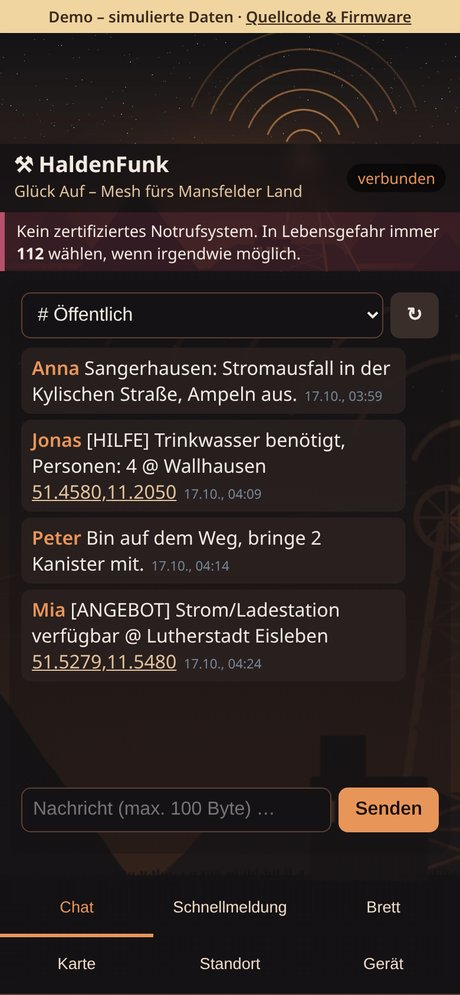
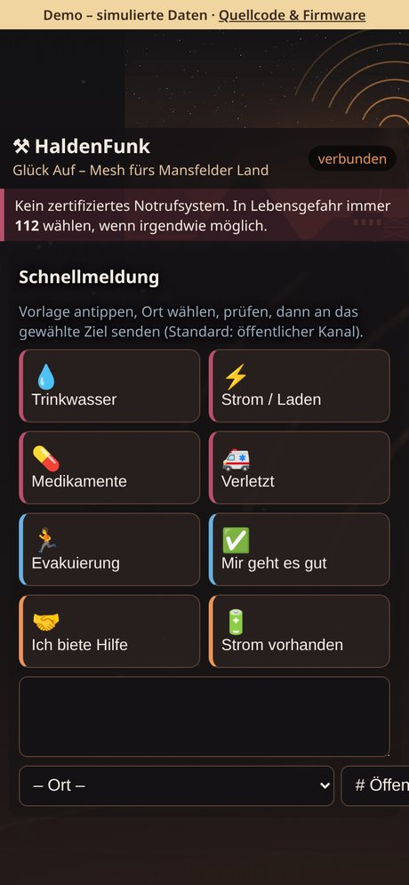
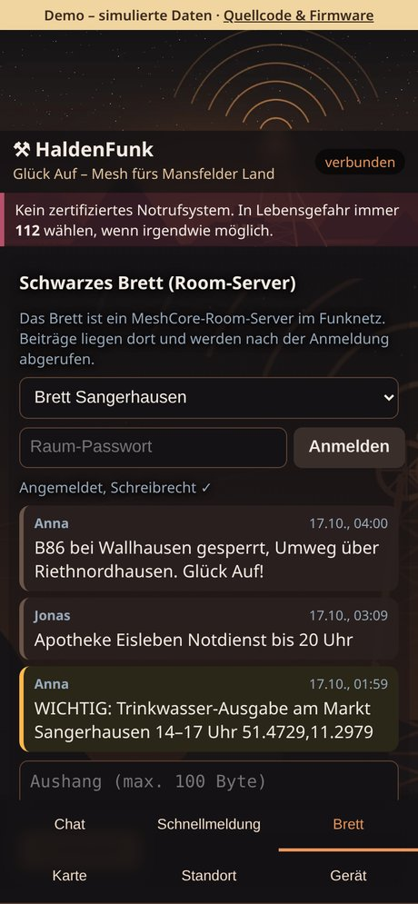
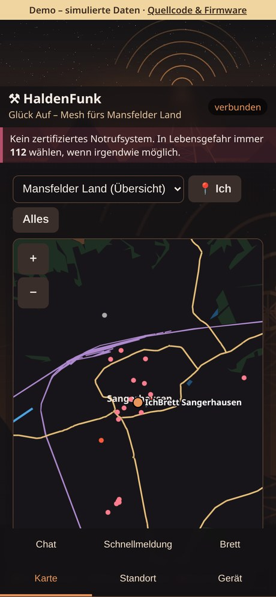
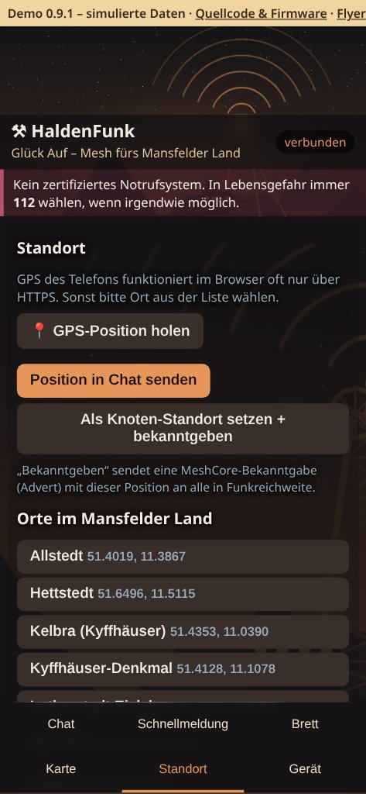
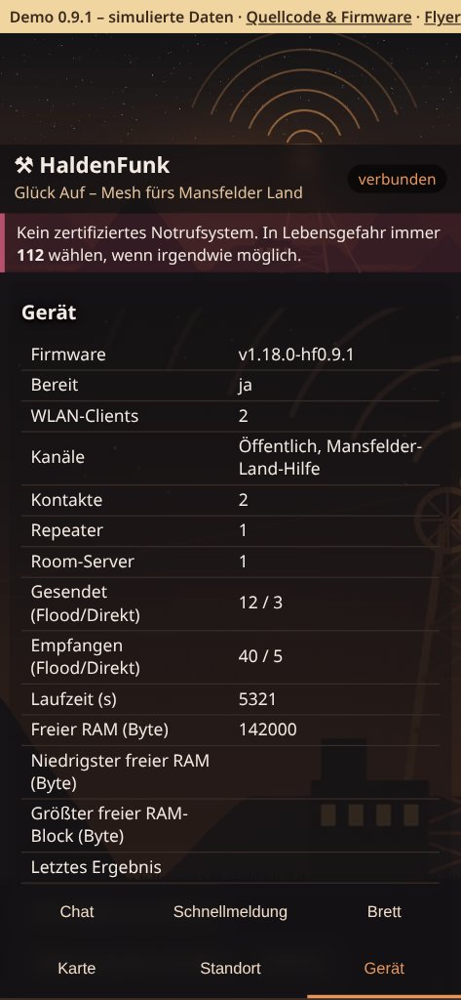

# HaldenFunk-MeshCore

> **Aktueller Stand:** offenes WLAN `HaldenFunk-XXXXXX` → `http://192.168.4.1`, MeshCore-App per Bluetooth ohne PIN, Brett (Room-Server) mit dem öffentlichen Gast-Passwort `hello` (sendet die Weboberfläche automatisch) – einfach verbinden, nichts eingeben. Betreiberfunktionen nur mit Admin-Passwort über USB/Admin-Bereich. [Zugang auf einen Blick](#zugang-auf-einen-blick) · [Zugang, Update und Abnahme](docs/OFFENER_ZUGANG.md)


**Glück Auf – Mesh fürs Mansfelder Land**

**🔴 Live-Demo (simulierte Daten, kein Gerät nötig): https://pietwars.github.io/HaldenFunk-MeshCore/**

**Version 0.9.1** · MeshCore **1.18** (Upstream `main` nach v1.18.0, Commit `81dbae59`) · Firmwarekennung `v1.18.0-hf0.9.1` · **Flyer (A5):** [Druck-PDF mit QR-Codes](docs/flyer/HaldenFunk-MeshCore-Flyer.pdf) · [Digital-PDF mit klickbaren Links](docs/flyer/HaldenFunk-MeshCore-Flyer-digital.pdf)

**HaldenFunk-MeshCore ist für [HaldenFunk](https://github.com/Pietwars/HaldenFunk), was [DisAHRsterRadio-MeshCore](https://github.com/Pietwars/DisAHRsterRadio-MeshCore) für DisAHRsterRadio ist:** der Code von DisAHRsterRadio-MeshCore (MeshCore 1.18, WLAN-Weboberfläche plus Bluetooth für die offizielle MeshCore-App, Gerätematrix der MeshCore-Konfigurator-Liste) mit dem regionalen Design und den Inhalten von HaldenFunk: Kupfer/Anthrazit, Haldenmotiv als Hintergrund, Orte und Offline-Karten des Mansfelder Landes (Sangerhausen, Lutherstadt Eisleben, Mansfeld/Hettstedt, Kelbra/Roßla/Kyffhäuser).

Das Board ist ein MeshCore-Companion und spannt ein eigenes WLAN **`HaldenFunk-XXXXXX`** (offen – einfach verbinden) auf. Man verbindet sich mit dem Handy und nutzt im Browser Chat, Schnellmeldungen, Brett, Karte und Standort – ohne App und ohne Internet. Parallel kann sich die MeshCore-App per Bluetooth verbinden.

> ⚠️ **Kein zertifiziertes Notrufsystem.** In Lebensgefahr immer **112** wählen, wenn irgendwie möglich.

> 📡 **Nicht funkkompatibel mit [HaldenFunk](https://github.com/Pietwars/HaldenFunk) und [DisAHRsterRadio](https://github.com/Pietwars/DisAHRsterRadio):** Diese beiden nutzen kein MeshCore, sondern LoRaLayer2 (disaster-radio). HaldenFunk-MeshCore spricht das normale MeshCore-Funkprotokoll und versteht sich mit anderen MeshCore-Knoten (z. B. DisAHRsterRadio-MeshCore, DisasterMesh) bei gleichem Funkprofil.

### Projektfamilie

| Repository | Inhalt | Funk | Version | Demo |
|---|---|---|---|---|
| [Pietwars/HaldenFunk-MeshCore](https://github.com/Pietwars/HaldenFunk-MeshCore) | **dieses Repo:** MeshCore 1.18, WLAN-Oberfläche im HaldenFunk-Design + Bluetooth für die MeshCore-App, Gerätematrix | MeshCore | 0.9.1 | [Live-Demo](https://pietwars.github.io/HaldenFunk-MeshCore/) |
| [Pietwars/HaldenFunk](https://github.com/Pietwars/HaldenFunk) | Mansfelder-Land-Variante von DisAHRsterRadio, **ohne MeshCore** (LoRaLayer2) | LoRaLayer2 | 0.9.1 | [Live-Demo](https://pietwars.github.io/HaldenFunk/) |
| [Pietwars/DisAHRsterRadio-MeshCore](https://github.com/Pietwars/DisAHRsterRadio-MeshCore) | Ahrtal-Original dieser Firmware: MeshCore 1.18, WLAN + Bluetooth (0.9.1 auf T-Deck Plus und Heltec V2 getestet) | MeshCore | 0.9.1 | [Live-Demo](https://pietwars.github.io/DisAHRsterRadio-MeshCore/) |
| [Pietwars/DisAHRsterRadio](https://github.com/Pietwars/DisAHRsterRadio) | Ahrtal, **ohne MeshCore**: modernisiertes disaster-radio | LoRaLayer2 | 0.9.1 | [Live-Demo](https://pietwars.github.io/DisAHRsterRadio/) |
| [Pietwars/DisasterMesh](https://github.com/Pietwars/DisasterMesh) | Original-Repo: MeshCore 1.18 mit großer Weboberfläche MeshAhrtal | MeshCore | 0.9.2 | [Live-Demo](https://pietwars.github.io/DisasterMesh/demo/) · [Release v0.9.2](https://github.com/Pietwars/DisasterMesh/releases/tag/v0.9.2) |

Gleiche Spalte „Funk“ = können miteinander funken (gleiches Funkprofil vorausgesetzt). Alle Demos sind simuliert. Auf Hardware getestet ist 0.9.1 bisher nur bei DisAHRsterRadio-MeshCore (T-Deck Plus, Heltec V2); HaldenFunk-MeshCore 0.9.1 ist auf Hardware nicht abgenommen.

**Download:** [Release v0.9.1](https://github.com/Pietwars/HaldenFunk-MeshCore/releases/tag/v0.9.1) mit den Paketen für **LILYGO T-Deck / T-Deck Plus** (`HaldenFunk-MeshCore-0.9.1-LilyGo_TDeck.zip`) und **Heltec WiFi LoRa 32 V2** (`HaldenFunk-MeshCore-0.9.1-Heltec_v2.zip`), je mit `factory.bin` (an **0x0**; überschreibt Einstellungen, Identität und Kontakte), deutscher `ANLEITUNG.md` und `SHA256SUMS`. Weitere Geräte bleiben im Code, sind aber vorerst nicht im Release.

**Web-Flasher (nur LILYGO T-Deck Plus):** [pietwars.github.io/HaldenFunk-MeshCore/flasher](https://pietwars.github.io/HaldenFunk-MeshCore/flasher/) – in Chrome/Edge am Computer, schreibt die `factory.bin` aus dem Release v0.9.1 an 0x0 (löscht Einstellungen). **Heltec V2 vorerst manuell** mit esptool bzw. esptool-js: [Anleitung Flashen](docs/FLASHEN.md) (Port finden unter Windows/macOS/Linux, Befehle, Update ohne Datenverlust).

## Zugang auf einen Blick

| Zugang | Aktueller Stand |
|---|---|
| WLAN `HaldenFunk-XXXXXX` | **offen, ohne Passwort** – verbinden, `http://192.168.4.1` öffnen, nichts eingeben (höchstens 4 Handys je Board) |
| Bluetooth (MeshCore-App) | **ohne PIN** („Just Works“) – das Handy fragt höchstens „Koppeln?“; alte Kopplung bei Bedarf am Handy entfernen |
| Schwarzes Brett (Room-Server) | öffentliches MeshCore-Standard-Gast-Passwort **`hello`**: damit lesen und schreiben. Die Weboberfläche sendet `hello` beim „Beitreten“ automatisch, niemand muss etwas eintippen. In der MeshCore-App `hello` eingeben; ohne Passwort nur lesen |
| Admin (nur Betreiber) | Für Betreiberfunktionen (Funkprofil, Name, Kanäle, Verwaltung von Repeater/Room-Server) gibt es ein Admin-Passwort. Es ist für jedes Gerät eigen, steht weder im Code noch in der Doku und wird nur beim ersten Start über USB (115200 Baud) angezeigt. Der Betreiber muss es dort ablesen und sicher aufbewahren oder ein eigenes setzen (bei Repeater und Room-Server per USB-Befehl `password <neu>` ändern). |

Außer dem öffentlichen Standard `hello` stehen keine Passwörter in Code, Doku, Flyern oder der Live-Demo; die Live-Demo öffnet den Adminbereich ohne Anmeldung. Details: [Offener Zugang](docs/OFFENER_ZUGANG.md).

> Hinweis: Ältere Releases (v0.1.0-alpha) enthalten noch die alten Zugangsregeln (WLAN-Schlüssel, Bluetooth-PIN, eigenes Raum-Passwort).

## Funktionen im Überblick

| Chat | Schnellmeldung | Brett |
|---|---|---|
|  |  |  |
| **Karte** | **Standort** | **Gerät** |
|  |  |  |

(Aufnahmen der [Live-Demo](https://pietwars.github.io/HaldenFunk-MeshCore/) in Handygröße, Stand 0.9.1; alle Daten simuliert.)

- **Chat:** öffentlicher Kanal, eigene Kanäle und Direktnachrichten, Verlauf auf dem Board
- **Schnellmeldung:** Vorlagen wie Trinkwasser, Strom, Medikamente, Verletzt, Evakuierung mit Ortsangabe
- **Brett:** Schwarzes Brett über einen MeshCore-Room-Server; Beitritt automatisch mit dem öffentlichen Gast-Passwort `hello` (lesen und schreiben)
- **Karte:** Offline-Karten des Mansfelder Landes direkt aus der Firmware, Knoten und geteilte Positionen
- **Standort:** Handy-GPS oder Ortsliste, als Chat-Position oder Knoten-Standort (Advert)
- **Gerät:** Status, Funkzähler, Kontakte, Bekanntgabe, Admin (Name, Kanäle; Admin-Passwort nur für Betreiber)
- **WLAN + Bluetooth gleichzeitig:** Auf ESP32-Geräten läuft das WLAN-Portal und parallel die Bluetooth-Verbindung für die offizielle MeshCore-App (siehe unten)

## Ehrlicher Stand (Oktober 2026)

| Punkt | Stand |
|---|---|
| Basis | MeshCore `main` nach **v1.18.0** (meshcore-dev/MeshCore), Git-Historie erhalten |
| Firmware baut | ✅ 105 Geräte (202 Builds, 36 Geräte mit WLAN-Portal) per GitHub Actions, Gerätematrix im CI (Status: [Actions](https://github.com/Pietwars/HaldenFunk-MeshCore/actions)) |
| Auf echter Hardware getestet | ❌ **diese Firmware noch nicht.** LILYGO T3 V1.6.1 lief beim Nutzer mit der Schwester-Firmware DisAHRsterRadio (gleiche Basis wie HaldenFunk) vollständig; Heltec V2 zeigte dort ein Strom-/Brownout-Problem (WLAN-AP fehlte), Gegenmaßnahme hier enthalten, ungeprüft |
| Kompatibel mit anderen MeshCore-Geräten/Apps | ✅ normales MeshCore-Funkprotokoll (gleiches Funkprofil vorausgesetzt) |

## Kartenbedienung und Speicheroptimierung

Die Navigation bleibt unten in zwei Reihen erreichbar (einschließlich iPhone-Safe-Area).
Die Kartenzeichenfläche ist auf ihren Container begrenzt; Zoomtasten sind 44 × 44 Pixel groß.
Im Browser werden maximal zwei Karten zwischengespeichert. Beim schnellen Wechsel gewinnt
immer die zuletzt gewählte Karte. Gleichzeitige Statusabfragen werden vermieden.

Die Weboberfläche wird beim Bauen gzip-komprimiert und direkt aus PROGMEM ausgeliefert.
Die genauen Roh- und gzip-Größen zeigt `python tools/embed_web.py` an (derzeit rund 19,6 kB
Ersparnis gegenüber derselben unkomprimierten Seite). `/api/state` überträgt Kontakte und
Kanäle stückweise, statt dafür einen großen Gesamt-String im Geräte-RAM anzulegen.
Unter „Gerät“ erscheinen freier RAM, bisheriges RAM-Minimum und größter freier Block.
Karten, Bluetooth, Kontaktlimit und Nachrichtenwarteschlange bleiben erhalten.

Regressionstest: `node tests/web_regression.cjs` (Node 22); prüft JavaScript-Syntax,
gzip-Roundtrip, CSS-Selektoren, Kartencache und überholte Ladeantworten. Dies ersetzt
keinen Safari-/Hardwaretest. Vor Freigabe auf iPhone Hoch-/Querformat, Tastatur,
Karte → Chat/Brett und auf dem Board mehrere WLAN-Clients sowie BLE parallel prüfen.

## Boards

| PlatformIO-Env | Board | App-Partition belegt (3 MB, `huge_app.csv`) |
|---|---|---|
| `disaster_t3s3_sx1262_wifi` | LILYGO T3-S3 SX1262 | ca. 62 % |
| `disaster_tlora_v2_1_sx1276_wifi` | LILYGO T3 V1.6.1 SX1276 | ca. 52 % (0.1.0-alpha: 85 %; NimBLE, -Os statt -O0, ohne Sensorbibliotheken; ca. 1,4 MB frei) |
| `disaster_heltec_v2_sx1276_wifi` | Heltec WiFi LoRa 32 V2 SX1276 | ca. 52 % (0.1.0-alpha: 70 %) |
| `disaster_t3s3_sx1262_repeater` / `_room` | T3-S3 SX1262 als Repeater / Room-Server (Brett) | ca. 29 % |
| `disaster_ttgo_repeater` / `_room` | T3 V1.6.1 / TTGO LoRa32 als Repeater / Room-Server | ca. 30 % (0.1.0-alpha: 44 %; Partition `min_spiffs.csv`, 1,9 MB) |

Weitere Profile (T3-S3 SX1276, SD-Archiv, Heltec-Diagnose) sind in `platformio.local.ini` enthalten, aber nicht im CI.

Heltec V2 mit WLAN-Fix: Brownout-Detektor früh aus, Startmarken `[DIAG …]` seriell, WLAN startet zuletzt und erst 2 s nach dem Funkmodul, WLAN-Sendeleistung 8,5 dBm.

Alle WLAN-Portal-Boards: offenes WLAN **`HaldenFunk-XXXXXX`** (höchstens 4 Handys, nichts eingeben). Auf dem OLED stehen WLAN-Name und Zugangshinweis. Bei einem fehlgeschlagenen AP-Start erfolgt alle 5 s ein neuer Versuch.

## WLAN-Portal und MeshCore-App gleichzeitig (Bluetooth)

Auf ESP32-Geräten mit Bluetooth sind Web-Portal und BLE-Companion beide am selben Companion angemeldet (MeshCore `MultiSerialInterface`): Jede Antwort und jede eingehende Nachricht geht an beide. Die offizielle MeshCore-App verbindet sich per Bluetooth, während Handys im WLAN die Weboberfläche nutzen.

- **Bluetooth ohne PIN:** Just-Works-Kopplung ohne Zahlencode (Handy fragt höchstens „Koppeln?“), auch mit NimBLE auf klassischen ESP32. Alte Kopplung bei Bedarf am Handy entfernen. Nachrichten, Kontakte, Uhrzeit, Status gehen über Bluetooth; Betreiberbefehle (Funk, Name, Kanäle, Schlüssel, Reset) nur über USB/Admin-Bereich; Details unter [Offener Zugang](docs/OFFENER_ZUGANG.md).
- **Grenzen:** Ruft die App Nachrichten aus der Warteschlange ab, sieht das Portal sie im Verlauf mit, die App aber nicht umgekehrt die Abrufe des Portals. Gleichzeitige Befehle aus App und Portal können sich in seltenen Fällen kreuzen. WLAN + Bluetooth + Webserver brauchen viel RAM. Klassische ESP32 ohne PSRAM (T3 V1.6.1, Heltec V2, T-Beam, Meshadventurer) nutzen deshalb ab 0.1.1-alpha **NimBLE** statt Bluedroid; das WLAN-Portal startet zuerst, Bluetooth nur bei genug freiem Heap, und ein Start-Wächter verhindert die Bootschleife (`[BOOT]`/`[HEAP]`-Zeilen seriell). Auf Hardware **noch nicht geprüft**.
- **Speicher:** Portal-Profile nutzen die Partition `huge_app.csv` (3 MB App, kein OTA, 896 KB SPIFFS). Belegung 0.1.1-alpha: T3 V1.6.1 ca. 52 %, Heltec V2 ca. 52 %, T-Beam ca. 54 %, T3-S3 ca. 62 %.
- **Upgrade 0.1.0-alpha → 0.1.1-alpha:** Partitionstabelle unverändert – es reicht `teile-wifi/firmware.bin` an **`0x10000`** zu flashen; Einstellungen, Identität und Kontakte bleiben erhalten. Klassische ESP32 (T3 V1.6.1, Heltec V2, T-Beam, Meshadventurer) wechseln auf NimBLE: die alte Kopplung in den Bluetooth-Einstellungen des Handys **entfernen und die MeshCore-App einmal neu koppeln**. Wer von einer Version **vor** 0.1.0-alpha kommt, flasht einmal komplett die `factory.bin` an `0x0` (neue Partitionstabelle, Identität wird neu erzeugt).

## So wird die Oberfläche auf MeshCore abgebildet

| Reiter | MeshCore |
|---|---|
| **Chat** | Öffentlicher Kanal, weitere Kanäle (Slots 0–7) und Direktnachrichten an bekannte Chat-Kontakte |
| **Schnellmeldung** | Vorlagen (Trinkwasser, Strom, Medikamente …) mit Ort, gesendet an Kanal oder Kontakt |
| **Brett** | MeshCore-**Room-Server**: Portal tritt automatisch mit dem öffentlichen Gast-Passwort `hello` bei, Beiträge lesen und schreiben (ohne Passwort nur lesen) |
| **Karte** | Offline-OSM-Karten (Mansfelder Land, Sangerhausen, Lutherstadt Eisleben, Mansfeld/Hettstedt, Kelbra/Roßla/Kyffhäuser) aus der Firmware. Angezeigt werden Knoten mit Standort in ihrer Bekanntgabe (Advert), Positionen aus Nachrichten und die eigene Position |
| **Standort** | GPS des Handys oder Ortsliste. „Position in Chat senden“ (Format `!DP1\|lat,lon\|zeit`, kompatibel zu DisasterMesh) oder als Knoten-Standort setzen und per Advert bekanntgeben |
| **Gerät** | Status, Funkzähler, Kontakte neu lesen, Advert senden; Admin: Knotenname, Kanal mit Schlüssel |

Nachrichten sind bei MeshCore auf **100 Byte** begrenzt.

## Bauen und Flashen

```bash
pip install platformio
python tools/embed_web.py                       # nach Änderungen an web/
pio run -e disaster_t3s3_sx1262_wifi -t upload
pio run -e disaster_t3s3_sx1262_wifi -t uploadfs  # nur einmal! (Dateisystem, löscht Identität)
tools/package.sh                                 # Flashpakete HaldenFunk-MeshCore-<Version>-<board>.zip
python3 tools/version.py                         # Version (einzige Quelle: [hf] version in platformio.local.ini)
```

Die Weboberfläche liegt in `web/index.html`. `tools/embed_web.py` bettet die gzip-komprimierte Seite, Hintergrundbild (WebP, 20 KB) und Karten (gzip, 223 KB) in `examples/companion_radio/PortalPage.h` und `PortalAssets.h` ein. Demo ohne Gerät: `web/index.html?demo=1` lokal öffnen.

## Alle Geräte (MeshCore-Konfigurator-Liste)

**Funkprofil (alle Geräte, alle Rollen):** MeshCore-Standard-Preset **EU/UK (Narrow)** – **869,618 MHz, Bandbreite 62,5 kHz, SF8, CR 4/8**, MeshCore-Standard-Syncword (privat, 0x12). Gesetzt über die Build-Flags `LORA_FREQ=869.618`, `LORA_BW=62.5`, `LORA_SF=8`, `LORA_CR=8` in `platformio.ini` (gilt für alle 105 Geräte der Matrix und die eigenen Profile). Teilband 869,4–869,65 MHz (SRD, ETSI EN 300 220 / BNetzA): max. 500 mW ERP (27 dBm), 10 % Sendezeit; die Firmware bleibt bei der bisherigen boardsicheren Sendeleistung (nicht erhöht). Alle Knoten eines Netzes müssen dasselbe Profil nutzen – Geräte mit älterem Stand (CR 4/5) einmal in der Weboberfläche auf „EU/UK Narrow“ stellen oder per CLI `set radio 869.618,62.5,8,8`.

Der Code für alle 105 Geräte der [MeshCore-Konfigurator](https://meshcore.co.uk/configurator/)-Liste bleibt erhalten (`tools/devices.upstream.json`, `tools/devices.json`, Envs aus `tools/gen_devices.py` → `platformio.devices.ini`; einzeln bauen mit `tools/build_device.sh <Gerät>`). Ab 0.9.1 baut das CI vorerst nur noch die beiden Release-Boards, und nur diese sind im Release:

| Gerät | Chip | Web-Oberfläche | Inhalt | Datei |
|---|---|---|---|---|
| LilyGo_TDeck (T-Deck / T-Deck Plus) | esp32s3 | ja | WLAN-Portal | `HaldenFunk-MeshCore-0.9.1-LilyGo_TDeck.zip` |
| Heltec_v2 | esp32 | ja | WLAN-Portal | `HaldenFunk-MeshCore-0.9.1-Heltec_v2.zip` |

Alle Geräte bauen: Workflow „Alle Geräte (MeshCore-Konfigurator-Liste)“ manuell mit `alle = true` starten.

## Grenzen / offen

- Nicht auf Hardware getestet, auch nicht das Zusammenspiel mit MeshCore 1.18
- Karten für den Flash verkleinert (`tools/shrink_maps.py`: Linien vereinfacht, Raster ca. 7 m in der Übersicht / 2 m in den Detailkarten, kleine Wald-/Wasserflächen und kurze Wegstücke weggelassen; Orte, Halden und Schächte vollständig): 633 KB → 223 KB, Übersichtskarte 335 KB → 90 KB. Zusammen mit den schlanken Profilen (0.1.1-alpha) liegt T3 V1.6.1 jetzt bei ca. 52 % der App-Partition (siehe Boards)
- Die Brett-Funktion braucht einen erreichbaren Room-Server (`disaster_t3s3_sx1262_room` bzw. `disaster_ttgo_room`, im CI gebaut, nicht auf Hardware geprüft)
- Positionsfreigabe: Wer einen Standort als Knoten-Standort setzt, schaltet das Teilen der Position in Adverts ein (bei 0,0 wieder aus)
- Funkprofil-Auswahl (Deutschland-Presets) aus DisasterMesh ist in der neuen Oberfläche nicht enthalten. Die API `/api/radio` existiert weiter
- Karten haben keine Navigation; Datenstand 17.10.2026 (aus HaldenFunk übernommen)

## Lizenz und Danksagung

- **MeshCore** © Scott Powell / rippleradios.com und Mitwirkende, **MIT-Lizenz** (`license.txt`). Original-README: [README.meshcore.md](README.meshcore.md).
- WLAN-Portal, Zustell-Warteschlange, Room-/Repeater-Anpassungen: aus [DisasterMesh](https://github.com/Pietwars/DisasterMesh) (MIT).
- Code-Basis: [DisAHRsterRadio-MeshCore](https://github.com/Pietwars/DisAHRsterRadio-MeshCore) (MIT).
- Regionales Design, Hintergrundbild, Orte und Karten: aus [HaldenFunk](https://github.com/Pietwars/HaldenFunk), vom selben Autor, hier unter MIT.
- Kartendaten © OpenStreetMap-Mitwirkende, ODbL 1.0 (`web/map/ODbL-1.0.txt`).

